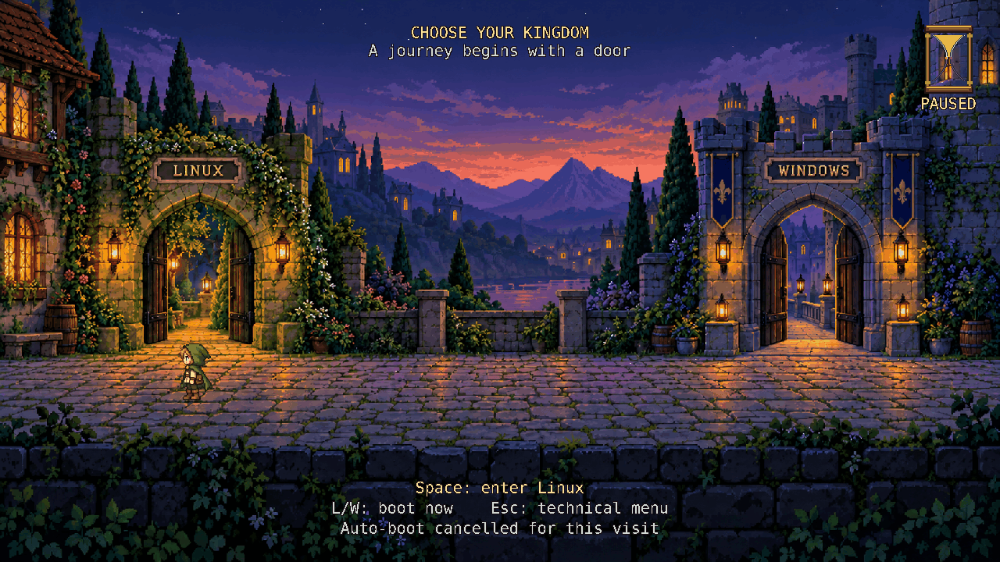

= A bourgeois grub

I always loved point and click adventure games.
Games where behind a door, behind an action, one could find a surprise.

On the other hand, grub is boring, unadventurous.
A simple but horrid thing.

This aims to fix that.
A bourgeois grub with a taste of adventure games.

bourgeois themes GRUB while preserving its existing OS boot logic and recovery paths.
Slim uses the unchanged distribution binary and a hero that snaps between doors.
Fancy adds a native GRUB module for walking and animated sand.

The recording uses the Fancy image confirmed on the physical host, running in disposable Secure Boot QEMU.
Linux selection uses a routing fixture.
The xref:docs/research/mockups/fancy-demo.png[still frame] is extracted from this GIF.

== Research

See xref:docs/research/README.adoc[the research and mockups] for the feasibility assessment, interface proposals, and source references.
The current xref:docs/research/mockups/slim-host-windows-selected.png[slim capture] and xref:docs/research/mockups/fancy-demo.png[fancy capture] show running GRUB in QEMU.

== Development lab

The first target is Ubuntu 24.04 LTS on x86_64 UEFI.
The lab uses a disposable QEMU disk; it does not change the host's boot configuration.
Windows lab tests use a routing fixture.
The separate Ubuntu 26.04 host workflow below covers the Secure Boot trial.
Both editions use the same courtyard artwork with stone-framed OS nameplates.

Install Python 3.11 or newer, Pillow, a C compiler, Make, QEMU, xorriso, and OpenSSH.
Install Pillow in the Python environment selected by `PYTHON`.
On macOS, install the VM tools with `brew install qemu xorriso`.
On Ubuntu, install `qemu-system-x86`, `qemu-utils`, `ovmf`, `xorriso`, and `openssh-client`.

[source,shell]
----
make vm
python3 tools/lab.py wait
make screenshot
make test
----

Use `make ssh` to inspect the running guest; exit the SSH session before continuing with host commands.
The first start downloads and checks the pinned Ubuntu image, creates an overlay disk, and configures a lab-only SSH key.
SSH listens only on `127.0.0.1:2229`.
Screenshots are saved under `build/evidence/`.
Guest disks, keys, downloads, and test outputs stay under the ignored `build/` directory.
Set `BOURGEOIS_SSH_PORT` to use another local SSH port.
Set `BOURGEOIS_FIRMWARE` if QEMU's UEFI firmware cannot be found in the standard locations.
Set `BOURGEOIS_FIRMWARE_VARS` for a matching variables template in a custom location.
`make lab-preflight` checks local VM tools and reports missing packages before starting a native build or preview.

== Slim preview

Prepare the two-entry menu inside the running guest:

[source,shell]
----
make slim
python3 tools/lab.py reset
----

Wait for the scene before sending keys.
Up/Down selects an entry and Enter boots it.
`l` and `w` boot immediately; Esc returns to Ubuntu's technical menu.
Any input cancels the 30-second automatic Linux boot.
The Windows choice is a routing fixture that prints a marker and returns.
The hourglass image is static in slim; its surrounding ring and seconds label count down.
The distribution's GRUB EFI binary stays unchanged.
The boot handoff and command line use a full-screen terminal instead of a centered box over the scene.
The host artwork variant shows a static traveler at the selected door; Fancy adds walking.
Slim's bottom menu follows the concept mockup: a centered dark panel with gold trim, an amber selected row, and an outlined unselected row.
For the headless lab, send keys with commands such as `python3 tools/lab.py key down` and `python3 tools/lab.py key ret`.

The installed VM hook refreshes the scene during each `update-grub`.
See xref:docs/research/implementation.adoc[the implementation notes] for entry ownership and recovery behavior.

=== Artwork for an existing host menu

The host tools require Python 3.11 or newer, Pillow, Make, sudo, `grub-mkfont`, `update-grub`, `grub-script-check`, and DejaVu Sans Mono.
On Ubuntu, install `python3-pil`, `make`, `sudo`, `grub2-common`, and `fonts-dejavu-mono`.
They update this machine's existing two-entry Linux/Windows clean menu.
Check the dependencies and inspect the graphics adapters without changing the system:

[source,shell]
----
make host-doctor
make host-gpu-select
----

The GPU chooser shows setup guidance for the selected adapter.
The tool identifies available adapters and recommends a connected firmware display adapter.
Firmware and monitor routing determine which adapter GRUB uses.
The chooser does not change firmware settings or Linux drivers.
`lspci` is optional; install `pciutils` for model names, or the report uses kernel PCI IDs.
See xref:docs/research/preview.adoc#host-gpus[GPU inspection] for explicit choices and limits.

Build and test the artwork without installing it:

[source,shell]
----
make host-stage
make test
----

Install or reinstall with one command:

[source,shell]
----
make host-install
----

This builds as your user, asks for sudo for installation, saves a backup under `/var/backups/bourgeois/`, and regenerates and checks both menus.
Dependency checks run before sudo and report missing packages.
It restores the previous files if installation or validation fails.
It writes only the artwork, a background hook, its own theme/resolution override, and the generated menus.
It does not install an EFI image or change firmware boot entries.
The default mode is the host-verified 2560x1440.
Set `HOST_SIZE=1280x720` to use the earlier verified mode.
The 3840x2160 trial did not work on this host, and its signed GRUB image does not include `videoinfo`.
The hero artwork must be built for the mode actually used.

Restore the last backup with:

[source,shell]
----
make host-rollback
----

Set `BACKUP` to an older printed backup directory when needed.
The static traveler switches doors when the native selection changes.
The supplied background hook keeps the courtyard visible behind GRUB's boot messages.
See xref:docs/research/preview.adoc#host-artwork[host artwork installation and rollback] for checks and recovery details.

== Fancy preview

In either lab preview, `l` boots Linux immediately.
Once Linux is running, build and select the custom EFI image:

[source,shell]
----
make native-build
make fancy
python3 tools/lab.py reset
----

Left/Right walks to a gate; Space enters at the threshold.
L/W boots immediately and Esc returns to Ubuntu's technical menu.
The animated sand and live seconds share the 30-second Linux timer.
Input cancels automatic boot for that visit; the original hourglass reads `PAUSED` and never resumes.
Full-scene rendering now uses a 17-millisecond frame budget, confirmed visible in a physical trial.
Repeated arrows preserve walking progress and keep the hero facing the selected gate.
This permits up to about 59 FPS when drawing fits the budget; actual performance depends on the firmware.
See xref:docs/research/fancy-performance.adoc[the performance record and physical trial limits].
Fancy inherits GRUB's display mode and scales its text and hourglass for the actual resolution.
Its centered gate prompts, walking behavior, and draining sand retain their own layout.
Boot messages keep the courtyard visible in a full-screen terminal.
The same `make host-gpus` and `make host-gpu-select` commands provide firmware display guidance for both editions.
The tools install a separate EFI file and boot entry inside the disposable guest.
They keep Ubuntu's original EFI binary intact.

See xref:docs/research/preview.adoc[the preview guide] for controls, recovery, removal, and packaging.
See xref:docs/research/validation.adoc[the validation record] for checked behavior and limits.

=== One-time host trial

The Ubuntu 26.04 host workflow uses a separate GRUB 2.14 image and explicit Secure Boot hash enrollment.
The host trial embeds trusted fonts, preserves the native boot commands, and uses the working 2560x1440 setting.
`make host-fancy-stage` builds without host boot changes; `make host-fancy-check` tests the staged image in Secure Boot QEMU.
Installation, enrollment, and `make host-fancy-once` are separate steps, keeping Ubuntu/Slim as the normal default.
Both earlier performance previews were withdrawn after physical black-screen reports; the host guide covers restoring a reviewed stage.
The subsequent isolated cadence and controller trials worked physically and are now the default Fancy source and stage.
See xref:docs/research/host-fancy.adoc[the host trial guide] for prerequisites, exact commands, verification limits, and removal.

To regenerate the walking GIF and its extracted still from the staged image, use the host guide's Secure Boot VM prerequisites and run:

[source,shell]
----
make host-fancy-demo
----

The files are written under `build/fancy-demo/trusted/`.
Set `HOST_FANCY_DEMO` to a fresh directory for another recording.

== Checks and packages

`make test` runs the Python and C checks without a VM.
`make test-c` runs only the C controller, layout, and command tests.
The command tests compile the module with GRUB service doubles and inject failures at the menu, graphics, authentication, and asset boundaries.
The native build compiles against the real GRUB headers and verifies the generated module separately.
Use Clang for static analysis and a compiler with AddressSanitizer and UndefinedBehaviorSanitizer for runtime checks:

[source,shell]
----
make test-c
make analyze-c
make sanitize-c CC=clang
----

`make analyze-c` requires Clang and treats analyzer findings as errors.
Set `CLANG` to select another Clang executable, or `CC` to select another test compiler.
Generated test headers and binaries stay under `build/c-checks/`.
Analyzer findings are printed in the terminal.
On macOS, if temporary-path checks fail because `/var` resolves to `/private/var`, run `TMPDIR=/private/tmp make test`.
After installing an edition in the running guest, `make boot-test` checks its input, boot, countdown, and recovery behavior.
Run only one boot-test process against the VM at a time, and inspect the runtime captures under `build/evidence/`.
After `make native-build` and `make fancy`, `make dist` packages both previews and checksums under `build/dist/`.
Packaging uses the cached EFI image and matching GRUB source archives and does not require a running guest.
The packaged previews target the disposable lab.
The separate host trial workflow is limited to the inspected Ubuntu 26.04 configuration.

== Licenses

Original project files outside `fancy/` use the MIT license in `LICENSE`.
The GRUB-specific code in `fancy/` uses GPLv3 or later; see `fancy/LICENSE`.
Upstream GRUB and other redistributed dependencies retain their own notices.
The generated host and Fancy UI fonts include the notice in `assets/DejaVu-font-license.txt`.
