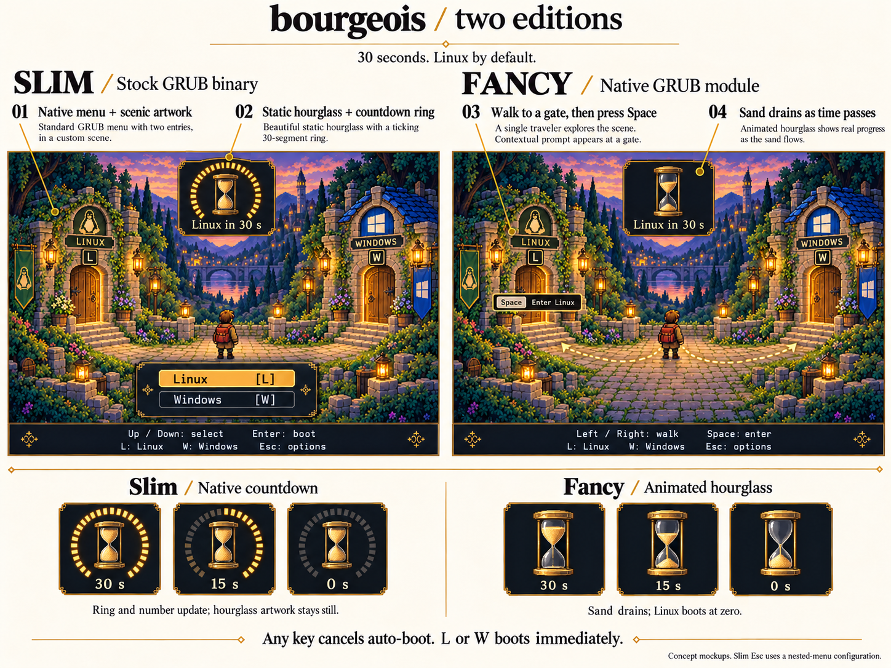
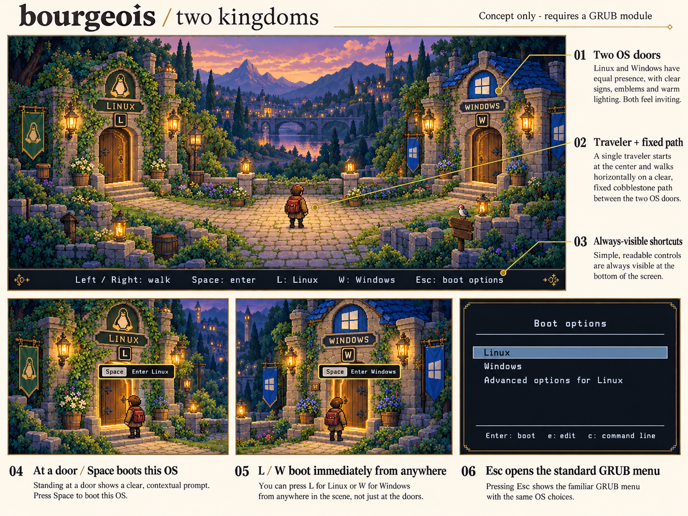

= Research and mockups

bourgeois themes GRUB while retaining GRUB's existing OS boot logic.
The research records what a stock theme can provide and what requires a native GRUB module.
See xref:implementation-plan.adoc[the approved implementation plan] and xref:implementation.adoc[the implementation notes] for the development preview.

== Current direction: both editions

The xref:two-editions.adoc[two-edition design] is the current direction.
Build a slim theme for an unchanged distribution GRUB binary and a fancy version with a native GRUB module.
Both show Linux and Windows, with a 30-second automatic Linux boot by default.
The proposed input policy cancels automatic boot on any key.

The xref:mockups/two-editions.png[comparison mockup] shows the native countdown ring for slim and animated sand for fancy.
The xref:mockups/two-editions.prompt.txt[exact generation prompt] is preserved alongside it.

The initial target is Ubuntu 24.04 x86_64 UEFI.
Secure Boot is deferred.

== Initial feasibility research

The xref:grub-feasibility.adoc[GRUB feasibility assessment] covers theme limits, input handling, boot-entry handoff, recovery, and Secure Boot packaging.
It includes the source references and proposed validation gates.
Its single-edition scope and indefinite wait are superseded by the current two-edition design.

The xref:mockups/adventure-concept.png[initial mockup] shows the courtyard, both OS doors, contextual prompts, and the technical menu.
The xref:mockups/adventure-concept.prompt.txt[exact generation prompt] is preserved alongside it.

The mockup is concept art generated with the built-in image generation tool.
It is not a screenshot of running GRUB or a production-ready asset set.
