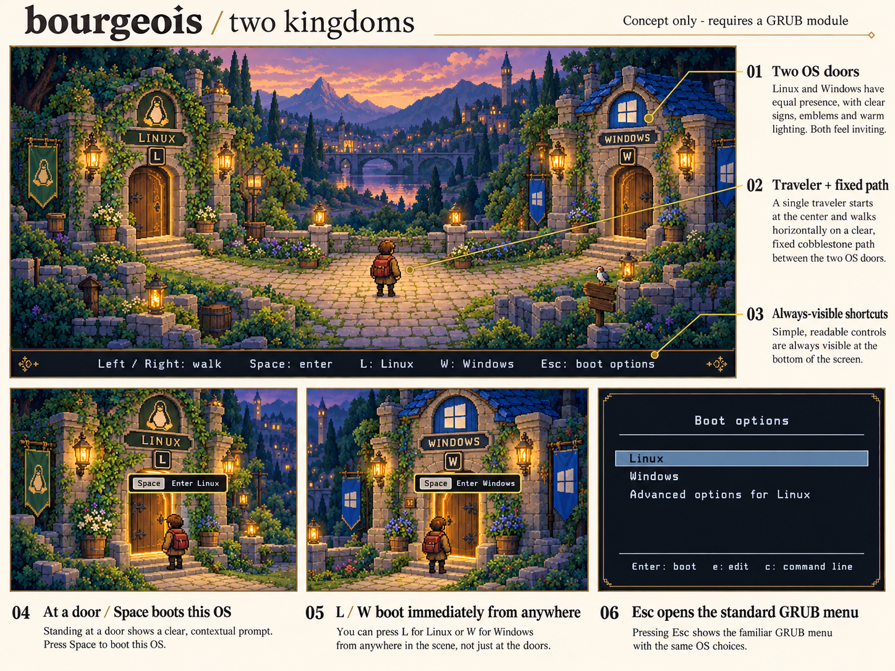

= bourgeois: GRUB feasibility and proposed design
:toc:
:toclevels: 2

Status: initial feasibility proposal, based on source inspection.
No GRUB module, theme package, installer, or boot configuration has been implemented.

== Mockup

The board shows the starting scene, both door interactions, and the technical menu.
It is concept art, not a screenshot of running GRUB.
The image was generated with the built-in image generation tool.
The xref:mockups/adventure-concept.prompt.txt[exact generation prompt] is saved with the image.

== Verdict

A beautiful adventure setting is feasible with GRUB's existing graphics facilities.
The requested walking interaction is not possible with a standard theme file alone.
I propose artwork plus a small native C module that runs inside GRUB.
GRUB would continue to load Linux and chain-load Windows through its existing menu entries.
This extends GRUB's presentation and input handling; it does not introduce another bootloader.

If the requirement is to install only a theme on an unchanged distribution GRUB, the complete interaction is out of scope.
That version could provide illustrated scenery, a styled menu, and Linux/Windows hotkeys, but would retain normal menu navigation.
A decorative character could not actually walk under theme control.

== Evidence and limits

I read the GNU GRUB 2.14 user manual, developer manual, and the official 2.14 source release.
The target machine's distribution build has not been identified or tested.
The feasibility conclusion comes from source inspection, not a running boot prototype.

The theme file describes components and appearance.
Its components include labels, images, progress indicators, a boot menu list, and layout containers.
It has no documented action handler, arbitrary keyboard binding, sprite controller, collision model, or general animation timeline.
A horizontal container does not turn the boot menu into two independently positioned door controls.
Timeout progress indicators do not provide a character animation system.

The source confirms the input boundary:

* `grub-core/normal/menu.c`, `run_menu`, owns normal menu keyboard input.
* Right Arrow boots the selected entry in the stock menu.
* Space has no built-in boot action in this switch.
* Esc exits a nested menu; at the top level it does not open an editing panel.
* `include/grub/menu_viewer.h` exposes selection, timeout, and finalization callbacks, but no general input callback or frame callback.
* A new viewer or theme component alone would not intercept the required controls.

GRUB does expose the lower-level facilities needed for a native module:

* `grub_getkey_noblock` for keyboard events.
* `grub_get_time_ms` and `grub_millisleep` for a bounded input and animation loop.
* `grub_video_bitmap_load`, bitmap scaling, alpha blitting, render targets, and buffer swaps for drawing.
* `grub_font_draw_string` and PFF2 bitmap fonts for live text.
* `grub_register_command` for a module-provided command.
* `grub_env_get_menu` for the menu already built while reading the configuration.
* `default` and `timeout` for handing the selected entry back to the normal menu flow.

The developer manual contains historical startup details.
Where those details differ from this release, I used the 2.14 source.
These internal interfaces must be checked against each supported GRUB build.

== Proposed interface

One compact courtyard contains two visible gates.
The Linux gate stands on the left; the Windows gate stands on the right.
Both gates have equal visual weight, a readable OS label, a distinct emblem, and a visible shortcut key.
A traveler starts midway along a short, fixed path.

The design takes its visual language from cozy pixel-art RPGs and classic adventure games.
It uses original artwork and keyboard controls.
Mouse-driven point-and-click input is not part of the first version.

[cols="1,3",options="header"]
|===
|Element |Behavior and implementation
|Courtyard |Static layered bitmap art. No scrolling camera or real-time lighting.
|Two gates |Static art plus a separate amber outline for the gate within interaction range.
|Traveler |Transparent sprite frames with idle and walking poses.
|Path |One authored route between two thresholds. No general pathfinding.
|Gate labels |Live text with a bitmap font. OS names remain explicit.
|Interaction prompt |`Space  Enter Linux` or `Space  Enter Windows`, shown only at the corresponding threshold.
|Shortcut strip |Always shows Left/Right, Space, L, W, and Esc.
|Boot options |The existing GRUB menu, entered through Esc. Existing advanced Linux entries remain available here.
|===

[cols="1,3",options="header"]
|===
|Input |Proposed result
|Left |Walk toward the Linux threshold. One press starts the short walk.
|Right |Walk toward the Windows threshold. One press starts the short walk.
|Opposite arrow during a walk |Reverse the destination without booting.
|Space at a threshold |Commit the corresponding OS choice.
|Space elsewhere or while walking |Do not boot or queue a future boot. Show a short hint to approach a gate.
|L or l |Boot Linux immediately, without waiting for movement.
|W or w |Boot Windows immediately, without waiting for movement.
|Esc |Cancel movement and show the standard GRUB menu with no countdown.
|===

I chose destination-based walking because GRUB's terminal input is based on key events.
Its common interface does not provide portable key-up events for ordinary arrow keys.
A press starts movement to a destination; the design does not depend on maintaining a held-key state.
I would not use WASD because W already boots Windows.

No automatic boot countdown would run in the scene by default.
The design waits for an explicit choice.
In the standard menu, `e` edits the selected entry and `c` opens the full GRUB command line, subject to existing authentication settings.
The restricted `grub rescue>` shell is a separate failure mode.
Esc cannot make this scene available if GRUB fails before it loads the module or its assets.

== Proposed implementation

=== 1. Establish the first supported system

Start with x86_64 UEFI and one agreed Linux distribution running alongside Windows.
Identify its exact GRUB package, patches, boot mode, generated menu layout, Secure Boot chain, and asset storage location.
Both operating systems must already boot through that GRUB installation.
Mixed BIOS/UEFI installations require a separate boot configuration assessment.

Record the existing working Linux entry ID and Windows Boot Manager entry ID.
Do not infer them from menu position or a translated title.
Retain the distribution's kernel update and recovery entry generation.
For a BLS-based distribution, resolve and test its current generated entry IDs through a distribution-specific adapter.

=== 2. Prove the integration in a virtual machine

Add an optional native module named `bourgeois` to an isolated build of the exact target GRUB source.
Register a `bourgeois` command.
Add its source and a module entry to `grub-core/Makefile.core.def`.
No change to the existing normal menu input loop is expected for this design.
The first prototype would use plain shapes, not final artwork.

A final configuration fragment would run after all normal boot entries have been created.
It would set a visible-menu fallback with no timeout before trying to load or run the scene.
It would invoke the command only for the supported graphical configuration, and honor one-shot boot requests and existing recovery policy.
An explicit disable setting would bypass the scene.

The command would validate that the two configured IDs resolve to the expected top-level, non-submenu boot entries.
Missing, duplicate, ambiguous, or invalid mappings would return to the standard menu.
It would never allow GRUB's missing-default behavior to silently select the first entry.

The command would run its own input loop before GRUB enters `run_menu`.
This avoids Right Arrow reaching the stock menu's boot action.
On a deliberate choice, it would restore the terminal, set `default` to that existing entry ID, set `timeout=0`, clear any cross-OS automatic fallback list for this explicit selection, and return.
Because this command runs last in the configuration, the normal flow would then boot that entry immediately.
It would not copy or execute Linux or Windows boot commands itself.

On Esc or a recoverable scene error, it would restore a readable terminal, use `timeout_style=menu` and `timeout=-1`, and return to the standard menu.
If a selected entry fails and returns to GRUB, the normal menu must remain accessible and the scene must not restart automatically.
The wrapper must not override a pending `grub-reboot` one-shot request or the distribution's failed-boot recovery behavior.

The source supports this sequence: `grub_normal_execute` reads the configuration before showing the menu, and `run_menu` honors `default` and an immediate timeout.
The prototype must verify graphics cleanup, authentication, failure handling, and one-shot boot behavior before proceeding.

=== 3. Add the movement and render loop

Use five scene states: center idle, walking left, walking right, Linux ready, and Windows ready.
Boot and exit are terminal outcomes of the scene.
Use one path with two threshold hit regions.
Only a ready state can accept Space.
Process Esc and the L/W shortcuts in every active scene state.

Use a 640 by 360 logical scene as the initial art target.
Place the two thresholds near x=128 and x=512, with the traveler near x=320.
Allow about 1.2 seconds from the center to either gate, with immediate reversal.
These are design targets for tuning, not measured GRUB performance.

Target 30 display updates per second and about 8 sprite pose changes per second while walking.
Check input between frames and avoid long blocking animation delays.
Static idle screens need redraws only when their state changes.
Use GRUB's existing video API and software drawing; no game engine, GPU API, browser, or OS service is required.

Preload bounded PNG images and live bitmap fonts.
Use nearest-neighbor scaling and integer scale factors where possible.
Center and letterbox the scene on wider or taller displays.
Keep OS labels, prompts, and shortcuts inside the safe scene area.
Text sizing must remain readable at each supported mode; it may need a separate output-size font choice.

A 640 by 360 RGBA bitmap uses about 0.88 MiB before scaling.
A 1920 by 1080 RGBA buffer uses about 7.91 MiB.
Actual peak memory includes decoded images, scaled images, sprite frames, and the video driver's buffers.
Measure it in the prototype; do not estimate memory use from compressed PNG size.

Prefer two cached scene layers and small transparent sprite/door overlays.
Verify the active driver and double-buffer semantics instead of assuming modern graphics performance.
A slower redraw rate or a static themed menu must remain an available fallback.

=== 4. Apply the approved art direction

Produce a courtyard background, foreground trim, traveler sprite sheet, gate outlines, prompt panels, and PFF2 fonts.
Keep graphics separate from entry IDs and machine-specific configuration.
Render text through GRUB rather than baking configuration-dependent labels into the artwork.
The concept board illustrates placement and states; it is not a production-ready sprite sheet or a GRUB screenshot.

=== 5. Package for the agreed distribution

Build the module against the exact supported GRUB release and distribution patches.
Treat compatibility as a tested package relationship, not a stable cross-version plugin ABI.
Keep the integration in a generator fragment or supported distribution hook rather than hand-editing generated `grub.cfg`.

Without Secure Boot restrictions, a matching loadable module is the simpler development route.
With the inspected GRUB 2.14 shim verifier active, an external GRUB module is rejected by its file-type policy.
The dependable design for that path is to embed the module and required dependencies into a GRUB image accepted by the existing trust chain.
Signing an external module or enrolling a MOK alone must not be assumed to make the distribution's existing GRUB accept it.
Signing, trusted-key enrollment, SBAT policy, and updates must be resolved for the selected distribution before promising installation support.
Disabling Secure Boot is not the proposed production solution.

The initial package would support one tested UEFI distribution and Windows installation pattern.
Legacy BIOS and additional distributions would be later compatibility work.
Retain an independently bootable standard GRUB path and the firmware's Windows Boot Manager path during validation.

=== 6. Validate before any real-machine installation

[cols="1,3",options="header"]
|===
|Area |Required evidence
|Input |Left/Right never boot. Reversal works. Space boots only at the correct threshold. L/l and W/w select the correct entry from every state. Esc always leaves an active scene.
|Boot handoff |Test both actual Linux boot and actual Windows Boot Manager handoff in a disposable dual-boot VM. A synthetic entry can test ID routing but does not prove Windows boot support.
|Recovery |Esc exposes entry editing, command line, advanced kernels, and recovery entries. Existing authentication remains effective.
|Failure |Missing module, malformed or missing assets, insufficient graphics support, missing Windows mapping, and returned boot failures leave a readable standard menu without an automatic wrong-OS boot.
|Display |Test 640x480, 1024x768, 1280x720, 1920x1080, and an ultrawide mode where the virtual or real firmware offers them. Check scaling, text size, buffer swaps, and peak memory.
|Updates |Regenerate the GRUB configuration after a kernel update. Verify Linux resolves to the intended current entry, while older kernels remain in advanced options.
|Policy |Verify one-shot boots, saved defaults, failed-boot handling, and Secure Boot on the actual supported package path.
|Hardware |After VM gates pass, verify firmware graphics and keyboard behavior on the agreed real machine. VM success alone is not hardware validation.
|===

== Proposed decision

I recommend the scene plus a native GRUB module if the walking interaction is essential.
The first implementation milestone should prove entry handoff, Esc recovery, and the distribution's module/signing route.
Final artwork should follow that gate.
If modifying or extending the installed GRUB binary is excluded, retain the visual direction but reduce the behavior to a normal themed menu.

Before implementation, the remaining inputs are the target Linux distribution and version, the installed GRUB build, UEFI versus BIOS, Secure Boot requirements, and acceptance of a native GRUB module.
These choices affect packaging and testing, not the illustrated scene's basic layout.

== References

* https://www.gnu.org/software/grub/manual/grub/html_node/Theme-file-format.html[GRUB 2.14 theme file format].
* https://www.gnu.org/software/grub/manual/grub/html_node/Menu-interface.html[GRUB menu interface].
* https://www.gnu.org/software/grub/manual/grub/html_node/menuentry.html[Menu entry IDs and hotkeys].
* https://www.gnu.org/software/grub/manual/grub/html_node/Simple-configuration.html[Defaults, timeouts, terminals, and OS detection].
* https://www.gnu.org/software/grub/manual/grub-dev/grub-dev.html[GRUB developer manual: graphical menu design and video API].
* https://www.gnu.org/software/grub/manual/grub/html_node/UEFI-secure-boot-and-shim.html[Secure Boot and shim support].
* https://ftp.gnu.org/gnu/grub/grub-2.14.tar.xz[Official source archive inspected].

Relevant source locations in that archive:

* `grub-core/normal/main.c`: configuration execution before the menu.
* `grub-core/normal/menu.c`: input dispatch, entry IDs, default selection, timeout, and execution.
* `grub-core/normal/context.c`: current menu access.
* `include/grub/menu_viewer.h`: viewer callbacks.
* `grub-core/gfxmenu/gfxmenu.c`: stock graphical viewer registration.
* `include/grub/term.h`, `include/grub/video.h`, `include/grub/bitmap_scale.h`, and `include/grub/time.h`: keyboard, graphics, scaling, and timing interfaces.
* `grub-core/kern/efi/sb.c`: shim verifier file-type policy.
* `util/grub.d/10_linux.in` and `util/grub.d/30_os-prober.in`: generated Linux and Windows entries.
