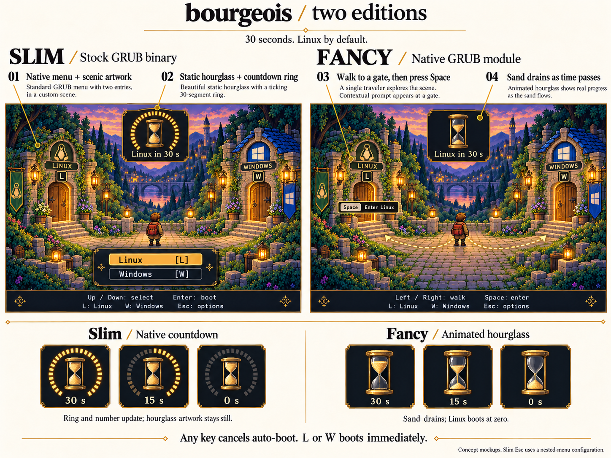

= bourgeois: two editions and a 30-second hourglass

This proposal updates the xref:grub-feasibility.adoc[initial feasibility assessment].
Both editions are requested.
The earlier proposal to wait indefinitely in the scene is superseded by a 30-second automatic Linux boot.
This remains design work; no boot configuration or executable code has been added.

== Mockup

The board compares both editions and the hourglass at 30, 15, and zero seconds.
It was generated with the built-in image generation tool.
The xref:mockups/two-editions.prompt.txt[exact generation prompt] is preserved with the image.
The fancy panel illustrates a possible door prompt.
In the running version, that prompt would appear only after arrival, with the countdown cancelled.

== Shared behavior

Both editions show exactly two OS choices: Linux and Windows.
Linux is the explicit default, rather than the last selected OS.
The automatic countdown starts at 30 seconds when the selection screen is ready.
With no input, Linux boots at zero.

Any key cancels automatic boot for that visit to the screen.
L or W also boots its corresponding OS immediately.
Navigating does not restart the timer or allow an automatic Linux boot while the user is choosing Windows.
This follows normal GRUB menu timeout behavior and is the proposed behavior for the module too.
If the timer is cancelled, the slim native timeout components disappear.
The fancy edition can replace its timer with a manual-selection label.

== Slim edition

Use the installed distribution GRUB binary with theme assets and supported configuration changes.
Use a scenic background and a native `boot_menu` with two vertically stacked entries.
A traveler, if present, is decorative static artwork.
The gates in the artwork are not independent interactive widgets.

Use Up/Down to select and Enter to boot.
Keep L/W as direct boot hotkeys.
Space and walking are not available in this edition.

The hourglass is a static image surrounded by a native `circular_progress` countdown with 30 ticks and `ticks_disappear` enabled.
Register the progress component and a seconds label with the special `__timeout__` ID.
A label template such as `Linux in %d s` provides the numeric countdown.
GRUB updates the ring and label once per second.
The sand inside the slim hourglass does not animate.
The three timer illustrations show full, half, and empty rings with unchanged hourglass artwork.

To preserve Esc as the route to technical options, place the two-choice themed menu in a nested configuration loaded with `configfile`.
Esc exits that nested menu and reveals the parent technical menu with no countdown.
The parent retains the existing advanced Linux and recovery entries.
A theme applied only to a top-level menu cannot redefine Esc this way.
The nested configuration therefore belongs to the slim package alongside the theme assets.
Generate its two boot definitions from the same distribution-specific source as the regular entries, so kernel updates refresh both configurations.
Do not maintain a second handwritten set of kernel paths.
The exact generation hook remains dependent on the first supported distribution.

== Fancy edition

Use the previously proposed native GRUB module and the same world artwork.
Keep the existing GRUB boot entry handoff and the Esc path to the technical menu.
Left/Right starts the character walking toward the corresponding gate.
Space boots only at the gate's threshold.

Animate the hourglass's upper sand level, thin stream, and lower sand pile.
Use the same remaining-time value for the sand state and numeric text.
The sand can change in discrete one-second steps; a few stream frames provide motion between those steps.
At zero, commit the existing Linux entry through the normal GRUB boot flow.
Do not add a mandatory walk after zero that delays the promised 30-second boot.
Movement, Space, or Esc cancels automatic boot; direct L/W input boots immediately.
The timer never continues behind technical options.

The module and trusted-image packaging remain specific to the supported GRUB build and Secure Boot path.

== Delivery sequence after design approval

. Select the first supported Linux distribution and verify both existing OS boot entries.
. Build and validate the slim theme, native countdown, and nested-menu Esc configuration.
. Share the approved world artwork and text with the fancy edition.
. Prove module input, the 30-second default handoff, timer cancellation, and recovery in a VM.
. Add walking and animated sand, then validate the agreed Secure Boot and hardware path.

The mockup is a comparison board, not a screenshot of running GRUB.
Both editions remain GRUB presentations of the same two operating systems.

== Evidence

* https://www.gnu.org/software/grub/manual/grub/html_node/Theme-file-format.html[Theme components and native timeout indicators].
* https://www.gnu.org/software/grub/manual/grub/html_node/Simple-configuration.html[Default entry, timeout, and cancellation on key input].
* https://ftp.gnu.org/gnu/grub/grub-2.14.tar.xz[Official GRUB 2.14 source inspected].

Source locations checked for this revision:

* `grub-core/gfxmenu/gui_circular_progress.c`: static center bitmap and disappearing ticks.
* `grub-core/gfxmenu/gui_label.c`: seconds label formatting and timeout visibility.
* `grub-core/gfxmenu/view.c`: native timer updates and cancellation.
* `grub-core/commands/configfile.c`: nested menu invocation and environment restoration.
* `grub-core/normal/menu.c`: keyboard cancellation and nested-menu Esc behavior.
