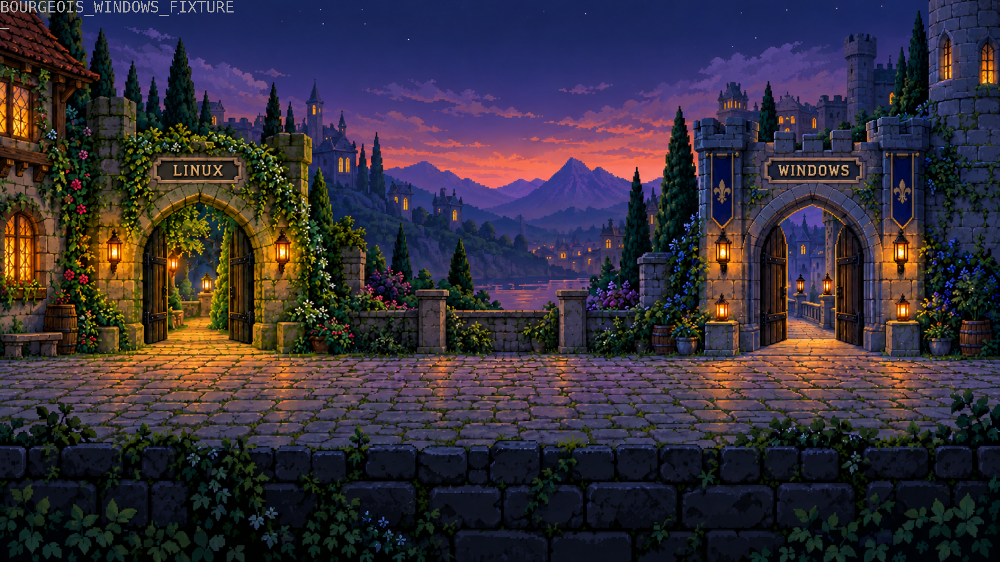
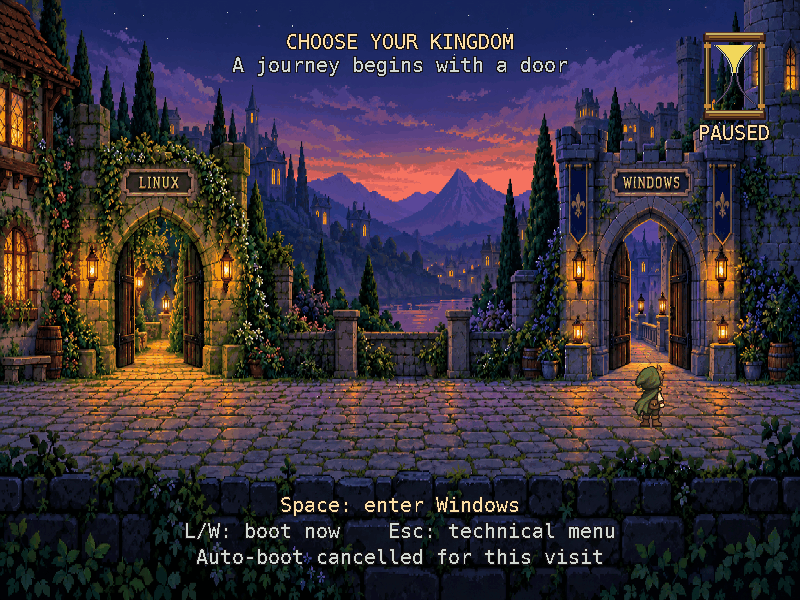
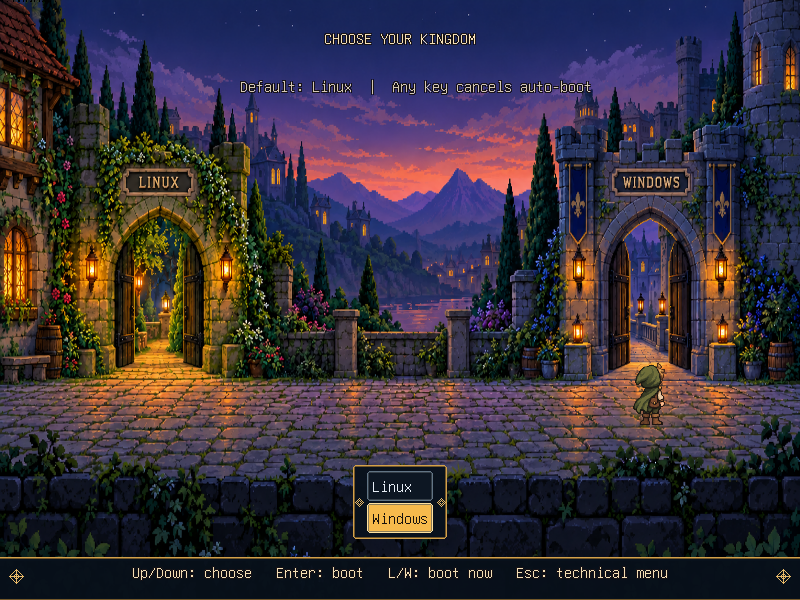
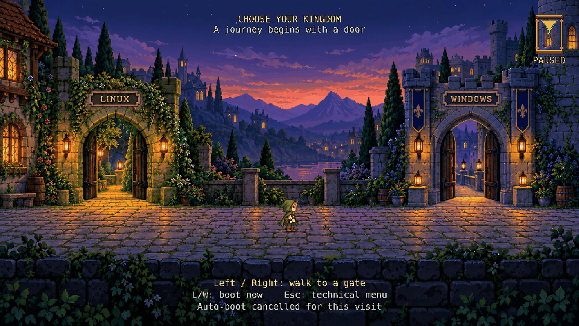

= Development validation

== Environment

* Host: ARM64 macOS, QEMU 11.1.3 with software emulation.
* Guest: Ubuntu 24.04.5 LTS, x86_64 UEFI, Linux 6.8.0-147-generic.
* Distribution GRUB: `2.12-1ubuntu7.3`.
* Ubuntu image: `noble/20261017/noble-server-cloudimg-amd64.img`, with the SHA256 pinned in `tools/ubuntu-image.json`.
* Ubuntu EFI binary SHA256 before preview testing: `a831af01e4fb5e3c9457120e1d08ea13d98a0a47b62728c284b7f502d535965c`.

The tests use a real Linux boot and a Windows routing fixture.
They do not validate Windows installation, Windows chainloading, Secure Boot, BIOS, other distributions, or hardware firmware.
The final check matched Ubuntu's original EFI digest above.
The installed custom EFI file matched `build/native/bourgeois.efi`, and the compiled module's source files matched `fancy/`.

== Local checks

`make test` runs the Python harness and generator tests plus the C controller tests.
The controller tests inject time and key events.
They check the 30-second boundary, cancellation, threshold-only Space, immediate shortcuts, movement, and reversal.
The generator tests check retained boot commands and authentication, fresh kernel paths, and invalid IDs.
The refresh tests check atomic replacement and failure preservation.

== Runtime evidence

The fancy keyboard suite passed in the Ubuntu guest.
It checked an untouched 30-second Linux boot, L and W routing, cancellation after more than 30 seconds, walking and reversal, and Space at the Windows gate.
The W fixture returned to the technical menu without re-running the scene.
The technical menu, entry editor, and command line were captured and visually inspected.

The slim keyboard suite also passed an untouched 30-second Linux boot, L and W routing, cancellation after more than 30 seconds, and Esc recovery.
Its technical menu, entry editor, command line, and returned Windows fixture were captured and visually inspected.
The full slim suite passed again after switching to the shared nameplate artwork.
It also passed after removing the title, menu, and control backing panels.
An earlier door-only Slim prototype also passed six cases.
They covered cancellation, repeated L/W selection without booting, single-Esc recovery after switching, the editor and command line, Space activation of both OS choices, and the untouched Linux timer.
The Windows fixture returned to a readable native two-entry boot menu.

image::mockups/fancy-runtime.png[Fancy GRUB at 2560x1440 with scaled UI and 15 seconds remaining,width=1280]

image::mockups/fancy-windows-gate.png[The traveler at the Windows gate with the Space prompt at 2560x1440,width=1280]

image::mockups/slim-runtime.png[Earlier door-only Slim prototype with the courtyard and native countdown,width=1280]

image::mockups/slim-windows-selected.png[Earlier door-only Slim prototype with the hero at the Windows door,width=1280]

image::mockups/slim-linux-selected.png[Earlier door-only Slim prototype after switching the hero back to the Linux door,width=1280]

image::mockups/technical-menu.png[Ubuntu's technical menu after Esc,width=800]

These images are actual QEMU screenshots of running GRUB.
The earlier concept boards remain design references.
Both editions show recessed architectural nameplates from `courtyard-nameplates.png`.
Fancy also has a freestanding hourglass.
The stone surrounds and lettering are part of the background artwork, following the original concept.
Fancy's title and help text use dark outlines, with the courtyard visible behind them.
The earlier menu-based Slim capture used text shadows and transparent backgrounds for its title, menu, countdown label, and controls.
Both selected rows were visually inspected, including the gold pointer at Windows.
The separate door-only prototype used two static hero positions and a contextual Space prompt.
Both of its door states were visually inspected in the unchanged Ubuntu GRUB binary.
The current compact menu and host theme are recorded below.
The live countdown was inspected at 30 and 15 seconds, with no backing panels.
After replacing the font labels with architectural artwork, the untouched timer, walking, reversal, Space at the Windows gate, Esc menu, and command line were checked again.
The missing-background check returned to a readable technical menu.
Fancy's three supported modes were visually inspected, including the xref:mockups/fancy-800x600.png[800x600 capture].
The screenshot checks reject blank frames and wait for `gfxterm` to finish switching modes under software emulation.

The Linux boot marker runs after `grub-common.service` clears `recordfail`.
Tests also wait for SSH and sync the guest before another boot.
This avoids treating a test's early power cut as a failed Linux boot.

== Rendering samples

The native renderer records draw time and live bitmap storage on exit when lab tracing is enabled.
These samples use software emulation on the ARM Mac, not KVM or real firmware.
The frame loop targets 25 frames per second; timer decisions use elapsed time.

[cols="1,1,1,1",options="header"]
|===
|Mode |Mean draw time |Largest sampled draw |Live bitmap bytes
|1280x720 |25 ms |185 ms |2,970,432
|1024x768 |27 ms |161 ms |2,596,480
|800x600 |16 ms |79 ms |1,584,160
|===

The 1024x768 sample contains 28 frames, and the 800x600 sample contains 29 frames.
The 1280x720 sample contains 743 frames from the untouched 30-second countdown.
The bitmap count covers the scaled courtyard and both facing directions of the traveler strip.
It excludes framebuffer storage, fonts, PNG decoder work space, and transient source images during scaling.
This is not a measurement of total GRUB heap use.
640x480 is rejected and returns to the technical menu.

== Fancy shared fixes on the Linux host

The native module was rebuilt against the pinned Ubuntu GRUB `2.12-1ubuntu7.3` source in a fresh disposable guest.
This additional run used Ubuntu 26.04.1 and QEMU 10.2.1 with x86 software emulation.
`make native-build`, `make fancy`, `make boot-test`, and the explicit fallback suite completed successfully.
The keyboard suite checked cancellation beyond 30 seconds, walking and reversal, Space at the Windows gate, both shortcuts, Esc tools, and the untouched Linux timer.
Linux booted successfully by shortcut and after the 30-second countdown.
The Windows route remains a routing fixture.

Fallbacks covered missing artwork, missing module, missing ID, unsupported 640x480, failed-boot state, and one-shot selection.
Rendering checks asserted the actual screenshot dimensions at 800x600, 1024x768, and inherited 2560x1440.
The high-resolution case uses `gfxmode=2560x1440,auto` with no Fancy override.
An additional 1440p check captured the live sand at 15 seconds, walked to Windows and used Space, and then booted Linux by shortcut at the same mode.
The 1440p UI uses the 40-pixel font and a doubled hourglass while retaining Fancy's composition and interactions.
The courtyard remains visible behind the fixture's boot message at both small and 1440p modes.
The earliest 1440p screenshot caught an incomplete repaint; captures from 0.3 through 2 seconds showed the complete courtyard.
The handoff harness allows the first repaint to finish before recording its evidence.
The original Ubuntu EFI digest still matches the one recorded above.
The custom EFI digest matches the locally built image, and the guest's compiled C source matches the repository.

`make test` passes 54 Python tests plus the C controller and layout tests.
The layout tests cover small displays, 1440p, 4K, narrow modes, and the font-size cap.
Only the listed rendering modes were boot-tested; the layout calculations alone do not validate a firmware mode.
The Fancy archive was checked for all six generated fonts, their notices, and the new layout source.
At that stage, the physical host continued using signed stock GRUB and Slim.
That disposable-guest run did not validate native Fancy installation or Secure Boot trust on the host.
The later host trial is recorded below.

== Fancy Secure Boot host trial

On 2026-11-01, Fancy was built for the inspected Ubuntu 26.04 host using its matching `grub2-unsigned` source and EFI modules, version `2.14-2ubuntu1`.
The separate EFI image embeds its fonts, artwork, and inspected native menu commands.
The 2560x1440 display setting is inherited from the working host configuration.
The trial uses image hash enrollment through MokManager; kernel-module-only certificates cannot authorize an EFI bootloader.

The exact staged image passed three disposable Secure Boot QEMU checks with the host's public SBAT revocation levels.
Its enrolled Authenticode hash allowed shim to load GRUB with `shim_lock=y` and render Fancy at 2560x1440.
Esc returned to the full native technical menu.
Shim rejected the same image without enrollment and rejected an altered image despite enrollment of the original hash.
Those virtual disks contain no installed operating systems; their scope is trust, rendering, and recovery-menu checks.

The host owner subsequently reported that the physical trial worked.
Read-only inspection confirmed that the running system had booted through the separate Fancy entry, the separate trial entry.
Secure Boot remained enabled, the original boot ordering was preserved with Ubuntu first, and BootNext had been consumed.
The report is user-observed physical validation; it is separate from the automated VM results.

The initial host preparation suite passed 72 Python tests and two C checks.
Its temporary-root tests cover native menu preservation, enrolled-hash checks, unchanged default ordering, existing BootNext preservation, stale snapshots, altered images, failed-copy cleanup, unexpected firmware-order recovery, and trial removal.
See xref:host-fancy.adoc[the host trial guide] for exact commands, the tested image hash, captures, and removal.
The installed image contains a menu snapshot; a changed kernel or menu requires rebuilding and enrolling the newly tested image before another trial.
Ubuntu/Slim remains the normal default.

== Fancy input polish

A Secure Boot QEMU reproduction showed that pressing Left again at the Linux gate turned the standing traveler toward Windows.
The renderer had inferred facing from `target < origin`, but those positions coincide after repeated input at a reached gate.
Facing now records the last requested direction independently of the travel distance.
The cancelled countdown label is now `MANUAL`, consistent with cancellation lasting for the entire scene visit.

The C regressions cover arrival at both gates, repeated arrows, direction reversal, and continued cancellation.
The withdrawn source's suite passed 75 Python tests and the C controller, layout, and animation checks.
The updated GRUB 2.14 image passed the Secure Boot acceptance, untrusted-image rejection, tamper rejection, 2560x1440 rendering, and Esc recovery checks.
The VM checker also walks to each gate and compares the complete standing frame before and after repeating that gate's arrow.
Both comparisons are pixel-identical.
The Linux-facing and Windows-facing captures were visually inspected.
The initial optimization preserved static scenery, targeted 60 FPS, polled input between frames, and drained sand at physical-pixel resolution.
Its 1440p VM benchmark measured 60.0 FPS for the countdown, up from 25.0 FPS, with mean drawing time reduced from 21 ms to under 1 ms.
Its input checks passed immediate L/W routing, Space only after arrival, cancellation beyond 30 seconds, and untouched Linux fixture routing at 30,000 milliseconds.
The same controller checks also passed at 800x600 in the preceding run.
See xref:fancy-performance.adoc[the performance record] and xref:fancy-performance.json[raw counters] for the methodology and complete results.
The physical trial of this optimization then produced a black screen, followed by automatic Linux boot after roughly 30 seconds.
The owner supplied the installed file hash and manifest, confirming that the tested optimization was installed.
It is withdrawn; the host installer, enrollment command, and one-time selector reject its hash while allowing removal.
The earlier successful physical trial refers to the original image.

The conservative replacement restores complete-scene drawing, per-frame input polling, relative pacing, and the original 25 FPS default.
It retains the controller corrections, faster pose changes, and fine sand movement.
The optional 60 FPS setting uses the complete-scene path.
The exact replacement passed the three Secure Boot cases, repeated gate comparisons, Esc, L/W, Space at the gate, cancellation beyond 30 seconds, and the untouched timer at 30,000 milliseconds.
The default timer rendered 750 frames in 30 seconds; the optional faster budget reached about 38 FPS in the same VM.
The owner then reported a physical black screen with the full-scene replacement too.
Its hash was enrolled and the separate Fancy entry was used; the installed file digest was not collected after this second report.
Both failing hashes are withdrawn from host installation, enrollment, and one-time selection, while removal remains available.
The exact cause remains unknown; the next physical check restores the preserved original image without new enrollment.
Original and replacement stages have byte-identical artwork, fonts, bootstrap configuration, native menu configuration, and SBAT metadata.
The owner then restored the preserved original image and confirmed that Fancy was visible again.
Read-only inspection confirmed the separate Fancy BootCurrent entry, Secure Boot enabled, unchanged Ubuntu-first BootOrder, and no pending BootNext.
The subsequent isolated cadence stage uses the original renderer with only its 40-millisecond frame interval changed to 17 milliseconds.
Its native module has the same size and differs by exactly two bytes encoding the interval constants.
The EFI core sections, other embedded modules, asset/font/configuration contents, and PE section sizes match the working image.
This isolates the cadence experiment from the withdrawn sand, controller, and rendering changes.
Its 2560x1440 Secure Boot VM run passed both gate captures, courtyard restoration, Esc, cancellation beyond 30 seconds, L/W, Space at the gate, and untouched Linux fixture selection.
Shim accepted its enrolled hash and rejected untrusted and altered copies.
The harness observed 1,153 frames over 31,158 milliseconds, about 37 FPS; this uses host monotonic time because the original renderer lacks newer scene timing counters.
The original gate-facing behavior is retained; this experiment does not claim the later facing fixes.
The owner subsequently confirmed that the cadence trial worked physically, while reporting that walking and changing direction felt mostly unchanged.
Secure Boot remained enabled, the separate Fancy entry was used, Ubuntu remained first in BootOrder, and BootNext was consumed.
The repository's default native source was then restored to this confirmed cadence code.
A fresh default build reproduced the exact full-file and Authenticode hashes of the physically tested stage.

== Isolated controller trial

The next stage changes only the controller and actor-facing selection on top of the confirmed cadence source.
The historical delta is retained in `fancy/controller-trial.patch`; its source and regressions are now included by default.
It preserves fractional walking progress under repeated arrows and the selected gate's facing after arrival.
The hourglass, labels, pose cadence, graphics loop, and profiling remain those of the working baseline.
Its C controller regressions and Secure Boot VM cases passed.
Standing frames at both gates remained pixel-identical after repeating their arrows, with no courtyard trails.
Immediate L/W, Space after arrival, cancellation beyond 30 seconds, Esc, and untouched Linux fixture selection passed.
The host harness observed 1,152 frames over 31,159 milliseconds, about 37 FPS.
The owner completed the physical controller trial and reported that all checks worked.
A fresh default build reproduced the exact tested image.
See xref:host-fancy.adoc[the host guide] for exact commands and rollback using a privately reviewed stage.
The restored default passes 82 Python tests and the C controller and layout checks.

== Gate poses and stars

The 2026-11-02 update adds independently twinkling stars, rear-facing gate poses, and a 240-millisecond turn and step on Space.
Both editions share the new pose sheet.
Fancy transfers a courtyard bitmap with the selected traveler to the terminal background, so boot messages retain the hero.

The strict native build passed against Ubuntu GRUB `2.12-1ubuntu7.3` in the disposable guest.
The Python suite ran 84 tests: 81 passed and three font-dependent checks were skipped on macOS.
The C controller, layout, pixel blending, and command checks passed.
Clang static analysis, AddressSanitizer, UndefinedBehaviorSanitizer, and GCC warning checks passed.
The Fancy guest suite passed cancellation, independent star changes, walking and reversal, Space at Windows, Esc recovery, immediate L/W, and the untouched Linux countdown.
Actual captures showed the gate poses, inward turn, and traveler behind the returned Windows fixture's boot message.
The Slim guest suite passed cancellation, Esc recovery, L/W routing, and the untouched Linux countdown.
An additional Up/Down check captured both rear gate poses and confirmed that switching back to Linux restored the same complete scene.
This update has not been tested on the physical host or with real Windows chainloading.

== Doorway feedback

The 2026-11-04 update adds a soft amber light behind the hero at a gate.
Fancy fades it in over 240 milliseconds after arrival and brightens it during the existing Space turn and step.
Leaving clears the light, and repeating the same arrow keeps the steady level.
The terminal handoff retains both the light and hero.
Slim uses the same steady light in its selected-entry icons.

The Ubuntu 24.04 x86_64 suite passed all 86 Python tests with no skips, including font-dependent artwork generation.
The C tests passed with GCC and Clang, plus Clang static analysis, AddressSanitizer with leak detection, and UndefinedBehaviorSanitizer.
The native module compiled against the pinned GRUB `2.12-1ubuntu7.3` headers with warnings treated as errors.
The Fancy capture check compares actual pixels at both thresholds, checks departure cleanup and repeated arrows, and measures Space brightening while the scene's help text is still visible.
Slim's Up/Down check captured both light positions and confirmed that returning to Linux restored the same complete scene.
Both editions retain the existing guest boot and recovery checks.
This update has not been tested on the physical host or with real Windows chainloading.

== Permanent Fancy installation

The 2026-11-04 permanent installer compiles the current checkout, upgrades an existing trial or installed image in place, and selects Fancy through persistent BootOrder.
`make test` passed the C tests and all 112 Python tests.
The host Fancy regressions cover image integrity, withdrawn-image rejection, trial migration, repeated installation without duplicate entries, pending firmware requests, copy and generation failures, enrollment cancellation, firmware order rejection, and uninstall recovery.
Kernel-refresh tests generate a new Fancy menu from changed native kernel commands while leaving the installed EFI image unchanged.
Invalid regenerated menus remove the stale Fancy configuration so the loader can use the distribution menu.

A fresh GRUB 2.14 permanent image loaded its disk configuration and rendered at 2560x1440 in disposable Secure Boot QEMU.
The trusted image passed repeated-arrow gate facing, walking cleanup outside the selected doorway light, Esc recovery, cancellation beyond 30 seconds, Space activation at a gate, immediate L/W routing, and the untouched Linux countdown.
Shim rejected the untrusted and altered images.
Actual courtyard and technical-menu captures were inspected.
The VM comparisons exclude the nine animated stars from standing-pose checks and account for each gate's existing amber light when checking the walking path.
Private builds, firmware variables, logs, and captures remain under ignored `build/` storage.

These checks use file-backed virtual disks, routing fixtures, and simulated firmware commands for the installer.
They do not install the permanent image on the physical host, perform real Windows chainloading, or confirm a new image hash in the physical MokManager.

== Comet in the night sky

Issue https://github.com/nlopes/bourgeois/issues/1[#1] adds a small comet with a fading blue tail and warm white head to Fancy.
It starts four seconds after the scene opens, flies for 4.5 seconds, and repeats every 18 seconds.
It continues when input pauses automatic boot.
The sprite uses one small RGBA bitmap and the existing scene redraw to clear its previous position.

Host C tests cover the flight window, direction, repeated passes, fade envelope, tail taper, display bounds, continued animation after input, allocation failure, and drawing failure recovery.
The C tests pass with GCC and Clang, Clang static analysis, AddressSanitizer, and UndefinedBehaviorSanitizer.
`make test` passes all 114 Python tests alongside the C tests.
A fresh native image was compiled against the matching Ubuntu GRUB 2.14 headers and checked by the module verifier.
`make host-fancy-comet` recorded actual Secure Boot QEMU frames and checked motion, the visible flight window, fading brightness at both ends, and complete tail cleanup.
The full Secure Boot benchmark passed gate facing, walking cleanup, Esc recovery, timer cancellation, gate activation, immediate L/W routing, and the untouched Linux countdown.
Shim accepted the enrolled image and rejected untrusted and altered copies.
The published GIF and still contain the courtyard scene without host identifiers or personal metadata.
This change has not been tested on physical firmware.

== Validation limits

An additional stock GRUB 2.14 UEFI rendering check on the Linux host reproduced the centered black handoff rectangle.
The optional host theme was checked at 1280x720 with dummy Linux and Windows entries in an isolated QEMU instance with no network or host disks attached.
The static traveler appeared at the selected gate and switched sides on Up/Down.
The terminal background retained the courtyard during both dummy handoffs, with diagnostic text still visible.
These rendering checks do not replace real OS boot validation.
The user separately reported successful Linux and Windows boots with the preceding host artwork installation.
The firmware mode list can differ from modes available after the operating system loads.
The tested preview uses the working 2560x1440 mode, including the selected-door hero.
The installed signed GRUB image omits `videoinfo`; Secure Boot refused loading that diagnostic's external module.
The host default is now the verified 2560x1440, with Secure Boot still enabled.
The bottom menu now follows the Slim concept's gold-trimmed panel, amber selection bar, outlined unselected row, and gold ornaments.
An isolated 2560x1440 GRUB 2.14 check covered the compact panel with Linux selection, Windows selection, and Linux reselection.
The complete panel is 242x148 pixels, down from 1040x216, and follows the measured longest title rather than a fixed width.
The selected fill is 178 pixels wide for the roughly 169-pixel Windows title.
It spans x=1191 through x=1368 in both states: center x=1279.5 against screen center x=1280.
The hero follows each selection without leaving its previous pose behind.
Both the host 1280x720 theme and the base theme with the distribution font were also checked with both selections.
The preceding countdown and courtyard handoff checks remain applicable; those components are unchanged by the compact layout.
The Fancy resolution-inheritance change is now rebuilt and boot-tested in the disposable guest, as recorded above.
Host-installer tests use temporary filesystem roots and simulated GRUB commands.
They check complete backup restoration after generation and syntax-check failures, staging checksum rejection, symlink rejection, and kernel refresh on rollback.
They do not run the privileged installer against the live host.
The shared test suite now passes 54 Python tests and the C controller/layout tests.
The menu regression checks keep its width within 1.5 times the longest title at both host font sizes and keep its anchor centered.
GPU tests cover both controller types, connector routing, ambiguous recommendations, explicit selection, missing sysfs, and optional `lspci` failure.
Dependency tests cover missing packages and keep build-only requirements out of rollback.
`make host-doctor`, explicit Intel guidance, JSON output, and interactive recommendation selection were checked on the host without changing its boot files.

image::mockups/slim-host-linux-selected.png[Stock GRUB at 2560x1440 with the gold Linux row and the traveler at the Linux door,width=1280]

image::mockups/slim-host-windows-selected.png[Stock GRUB at 2560x1440 with the gold Windows row and the traveler at the Windows door,width=1280]

image::mockups/slim-host-handoff.png[Courtyard retained behind a dummy Windows handoff message,width=1280]

The fallback tests use alternate GRUB configurations in the same disposable guest.
The missing-module fixture clears the capability flag and requests a nonexistent module.
The failed-boot and one-shot fixtures inject those state variables before the hook.
They do not exercise a physical EFI-image removal or persistent `grub-reboot` state across firmware restarts.
Password rejection is handled through GRUB's authentication API but has not been tested with an interactive password in the VM.
Kernel-refresh tests use changed configuration input; no additional kernel package was installed for an upgrade test.
The harness can select KVM on a Linux host, but this run used TCG on macOS.

== Package checks

Repeated packaging with the same inputs produced identical SHA256 checksums.
Archive metadata uses fixed timestamps and owner IDs.
Both archives include the generated theme, project source, and license notices.
The fancy archive also includes the EFI image and matching Ubuntu GRUB source archives.
The archived door-only Slim package passed all 20 Python tests and the standalone C controller checks at that stage.
