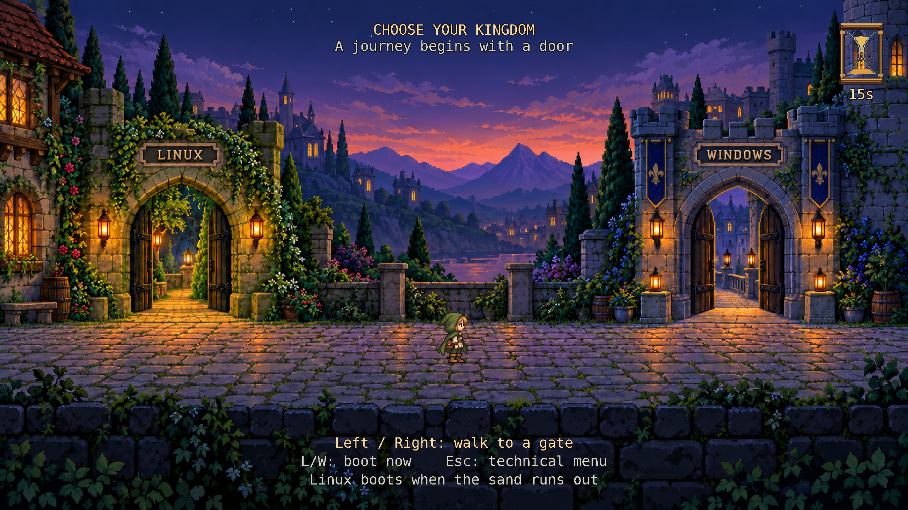
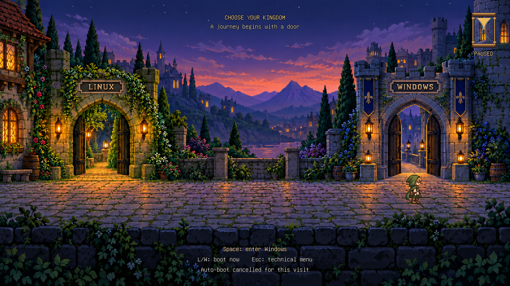
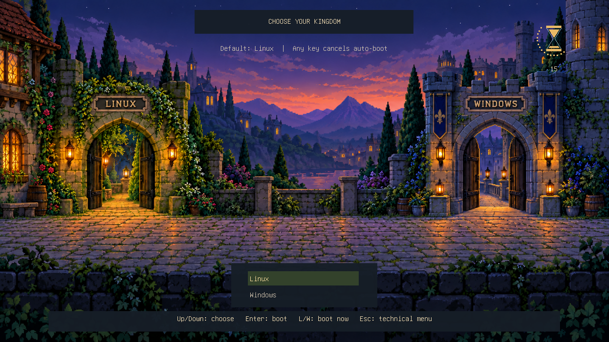
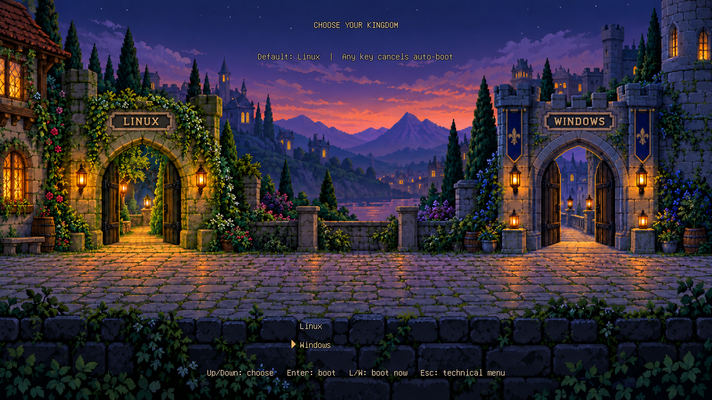
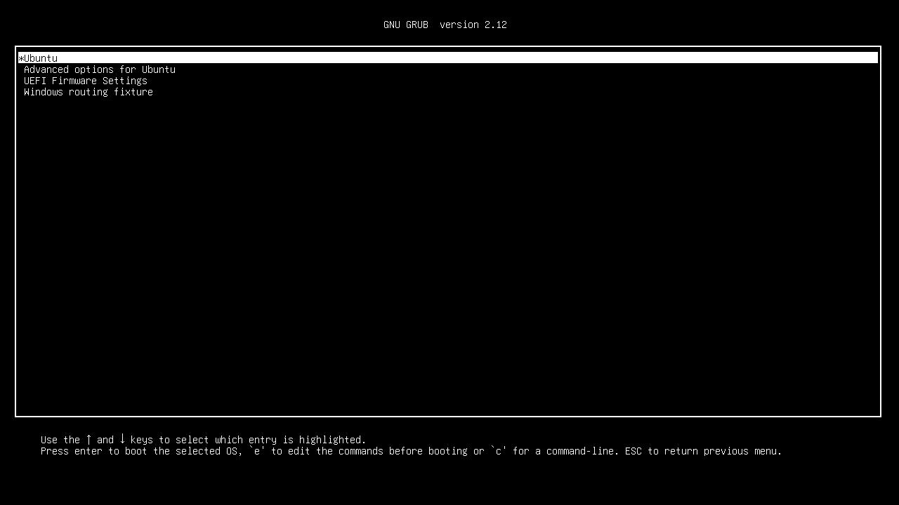
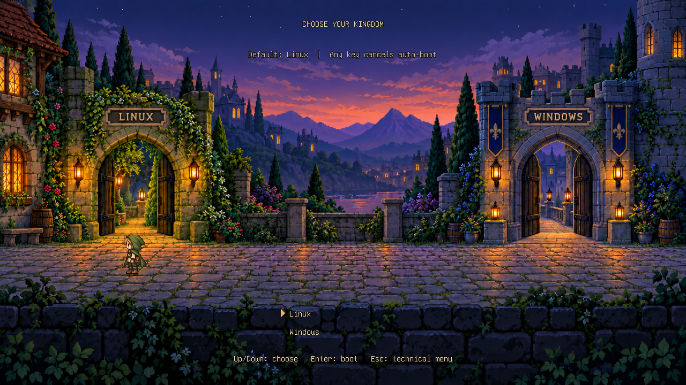
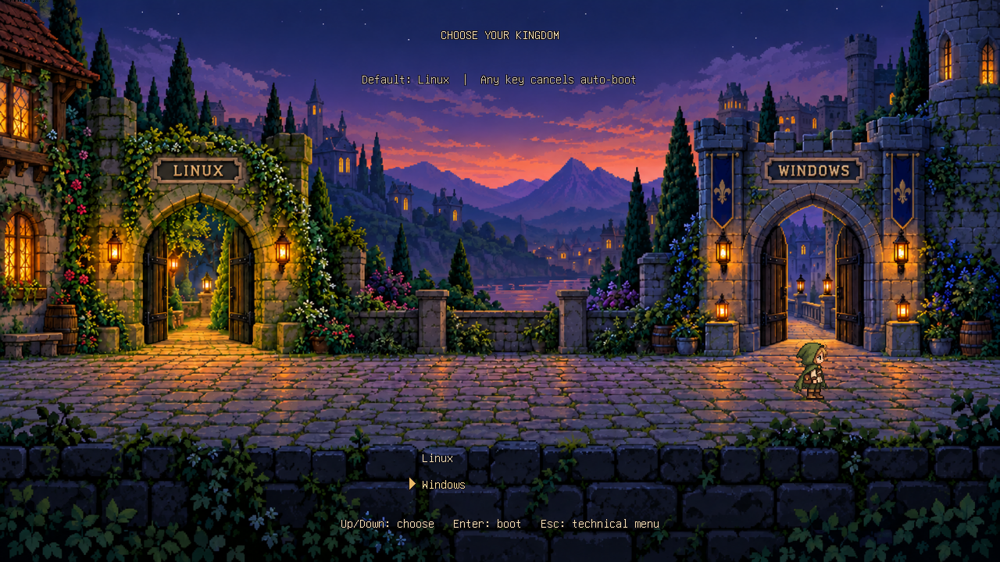
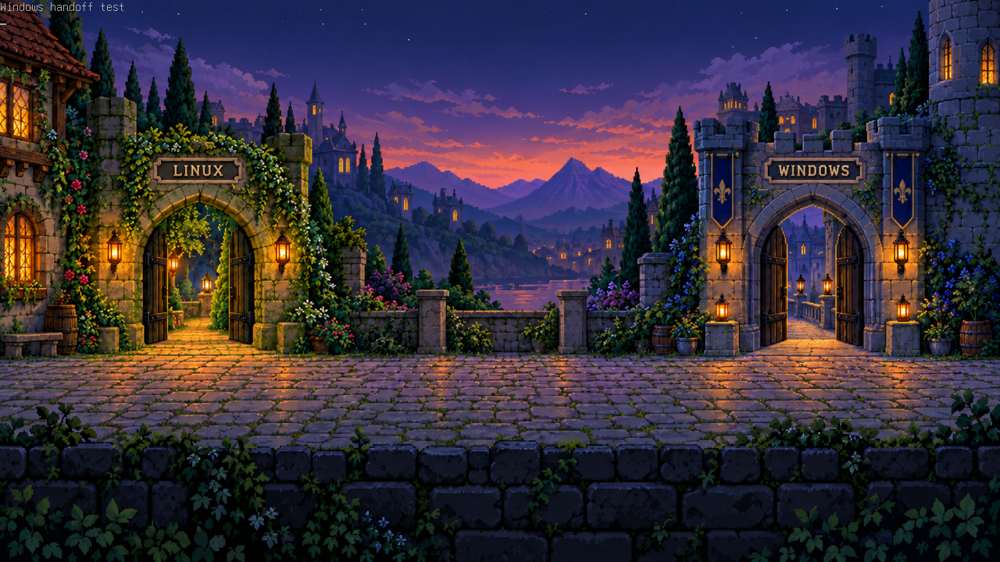

= Development validation

== Environment

* Host: ARM64 macOS, QEMU 11.1.3 with software emulation.
* Guest: Ubuntu 24.04.5 LTS, x86_64 UEFI, Linux 6.8.0-147-generic.
* Distribution GRUB: `2.12-1ubuntu7.3`.
* Ubuntu image: `noble/20261017/noble-server-cloudimg-amd64.img`, with the SHA256 pinned in `tools/ubuntu-image.json`.
* Ubuntu EFI binary SHA256 before preview testing: `a831af01e4fb5e3c9457120e1d08ea13d98a0a47b62728c284b7f502d535965c`.

The tests use a real Linux boot and a Windows routing fixture.
They do not validate Windows installation, Windows chainloading, Secure Boot, BIOS, other distributions, or hardware firmware.
The final check matched Ubuntu's original EFI digest above.
The installed custom EFI file matched `build/native/bourgeois.efi`, and the compiled module's source files matched `fancy/`.

== Local checks

`make test` runs the Python harness and generator tests plus the C controller tests.
The controller tests inject time and key events.
They check the 30-second boundary, cancellation, threshold-only Space, immediate shortcuts, movement, and reversal.
The generator tests check retained boot commands and authentication, fresh kernel paths, and invalid IDs.
The refresh tests check atomic replacement and failure preservation.

== Runtime evidence

The fancy keyboard suite passed in the Ubuntu guest.
It checked an untouched 30-second Linux boot, L and W routing, cancellation after more than 30 seconds, walking and reversal, and Space at the Windows gate.
The W fixture returned to the technical menu without re-running the scene.
The technical menu, entry editor, and command line were captured and visually inspected.

The slim keyboard suite also passed an untouched 30-second Linux boot, L and W routing, cancellation after more than 30 seconds, and Esc recovery.
Its technical menu, entry editor, command line, and returned Windows fixture were captured and visually inspected.
The full slim suite passed again after switching to the shared nameplate artwork.
It also passed after removing the title, menu, and control backing panels.
After replacing the menu with static door selection, all six slim cases passed again.
They covered cancellation, repeated L/W selection without booting, single-Esc recovery after switching, the editor and command line, Space activation of both OS choices, and the untouched Linux timer.
The Windows fixture returned to a readable native two-entry boot menu.

These images are actual QEMU screenshots of running GRUB.
The earlier concept boards remain design references.
Both editions show recessed architectural nameplates from `courtyard-nameplates.png`.
Fancy also has a freestanding hourglass.
The stone surrounds and lettering are part of the background artwork, following the original concept.
Fancy's title and help text use dark outlines, with the courtyard visible behind them.
Slim's title, countdown label, and controls use text shadows with transparent backgrounds.
Its visible menu was replaced by two static hero positions and a contextual Space prompt.
Both door states were visually inspected in the unchanged Ubuntu GRUB binary.
The live countdown was inspected at 30 and 15 seconds, with no backing panels.
After replacing the font labels with architectural artwork, the untouched timer, walking, reversal, Space at the Windows gate, Esc menu, and command line were checked again.
The missing-background check returned to a readable technical menu.
Fancy's three supported modes were visually inspected, including the xref:mockups/fancy-800x600.png[800x600 capture].
The screenshot checks reject blank frames and wait for `gfxterm` to finish switching modes under software emulation.

The Linux boot marker runs after `grub-common.service` clears `recordfail`.
Tests also wait for SSH and sync the guest before another boot.
This avoids treating a test's early power cut as a failed Linux boot.

== Rendering samples

The native renderer records draw time and live bitmap storage on exit when lab tracing is enabled.
These samples use software emulation on the ARM Mac, not KVM or real firmware.
The frame loop targets 25 frames per second; timer decisions use elapsed time.

[cols="1,1,1,1",options="header"]
|===
|Mode |Mean draw time |Largest sampled draw |Live bitmap bytes
|1280x720 |25 ms |185 ms |2,970,432
|1024x768 |27 ms |161 ms |2,596,480
|800x600 |16 ms |79 ms |1,584,160
|===

The 1024x768 sample contains 28 frames, and the 800x600 sample contains 29 frames.
The 1280x720 sample contains 743 frames from the untouched 30-second countdown.
The bitmap count covers the scaled courtyard and both facing directions of the traveler strip.
It excludes framebuffer storage, fonts, PNG decoder work space, and transient source images during scaling.
This is not a measurement of total GRUB heap use.
640x480 is rejected and returns to the technical menu.

== Validation limits

An additional stock GRUB 2.14 UEFI rendering check on the Linux host reproduced the centered black handoff rectangle.
The optional host theme was checked at 1280x720 with dummy Linux and Windows entries in an isolated QEMU instance with no network or host disks attached.
The static traveler appeared at the selected gate and switched sides on Up/Down.
The terminal background retained the courtyard during both dummy handoffs, with diagnostic text still visible.
These rendering checks do not replace real OS boot validation.
The user separately reported successful Linux and Windows boots with the preceding host artwork installation.
The monitor advertises 3840x2160 in Linux; the host firmware's GRUB mode list has not yet been confirmed.
The Fancy resolution-inheritance change has not yet been rebuilt or boot-tested as a native EFI image.

The fallback tests use alternate GRUB configurations in the same disposable guest.
The missing-module fixture clears the capability flag and requests a nonexistent module.
The failed-boot and one-shot fixtures inject those state variables before the hook.
They do not exercise a physical EFI-image removal or persistent `grub-reboot` state across firmware restarts.
Password rejection is handled through GRUB's authentication API but has not been tested with an interactive password in the VM.
Kernel-refresh tests use changed configuration input; no additional kernel package was installed for an upgrade test.
The harness can select KVM on a Linux host, but this run used TCG on macOS.

== Package checks

Repeated packaging with the same inputs produced identical SHA256 checksums.
Archive metadata uses fixed timestamps and owner IDs.
Both archives include the generated theme, project source, and license notices.
The fancy archive also includes the EFI image and matching Ubuntu GRUB source archives.
The extracted slim archive passed all 20 Python tests and the standalone C controller checks.
